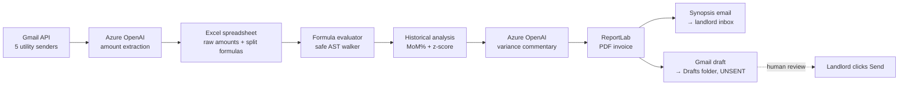

# Azure OpenAI Billing Assistant

A human-in-the-loop utility billing automation that reads bills from Gmail with **Azure OpenAI**, writes them into a spreadsheet that owns the split logic, flags month-over-month anomalies, and stages outbound emails as drafts for human review before send.

Built to replace a real, monthly manual process: log into five utility portals, copy amounts into a spreadsheet, calculate the tenant's share, generate a PDF invoice, write an email, attach the PDF, send. Now it's one command.

```bash
python3 run_billing.py --month 2026-04
```

## Results

| | Before | After |
|---|---|---|
| Time per billing cycle | ~45 min | ~2 min (review the draft, click Send) |
| Steps requiring a human | ~20 | 1 (approve + send) |
| On-time invoices | Inconsistent (depended on me remembering) | Runs unattended on the 10th, alerts me if it can't finish |
| Azure OpenAI cost per run | n/a | < $0.01 |
| Reconciliation errors found | Discovered a $14.79 cumulative discrepancy across 6 months of manual entry | Spreadsheet is the single source of truth; splits can't silently drift |

The system has been running in production since April 2026 and bills a real tenant every month.

---

## A note on how this was built

Claude wrote most of the Python here. I'm not a software engineer and I take my first Python class this fall, so it seems worth saying rather than letting you assume otherwise.

What I did bring: the Azure OpenAI setup and model choice, the Google Cloud OAuth configuration, the decision to keep the split logic in spreadsheet formulas instead of code, the decision that the system never sends an email on its own, and the diagnosis of the scheduler failure described below. The code was the easy part to get. The decisions about what this thing should do when it's uncertain took longer, and they're the only parts I'd defend.

---

## The problem

Five utility providers. Five email formats. Five marketing-laden HTML templates that bury the dollar amount inside nested tables. Once a month, a landlord (me) burns ~45 minutes copying amounts into a spreadsheet, computing a custom split (some utilities 50/50, some 100% tenant, water capped at $125), and writing the tenant a polite email with the PDF attached.

The hard part isn't the math, it's the unstructured input. Each provider's email looks different, and the regex approach I started with broke every time someone added a new tracking pixel.

LLMs are very good at this kind of extraction.

## What it does

```
Gmail (5 utility bills)
        │
        ▼
Azure OpenAI extracts dollar amounts from messy HTML emails
        │
        ▼
Raw amounts written to Excel spreadsheet (single source of truth for splits)
        │
        ▼
Spreadsheet formulas compute tenant share (re-evaluated by a safe Python AST walker)
        │
        ▼
6 months of history compared → MoM% + z-score anomaly detection
        │
        ▼
Azure OpenAI writes 4–6 sentences of variance commentary
        │
        ▼
PDF invoice generated (ReportLab)
        │
        ├──► Synopsis email sent to landlord (commentary + flags + PDF attached)
        └──► Gmail draft created for tenant (UNSENT, sits in Drafts until human review)
```

## Architecture



## Why Azure OpenAI?

Two LLM-shaped problems, both solved with `gpt-4o-mini`:

| Task | Why an LLM | Why mini-class |
|---|---|---|
| Extract a single dollar amount from a ~5KB HTML email padded with tracking pixels and CSS | Five providers, five formats, three of which use marketing-template emails where the amount is buried deep in HTML tables. A regex-only approach broke once per quarter. | The task is trivially within mini-class capability. Larger models add cost without measurable quality gain. |
| Write 4–6 sentences of plain-language variance commentary on this month's anomalies | Numerical anomaly detection is easy; *explaining* a 30% electricity drop in a way a non-finance reader will understand requires a narrative model. | Same reasoning, short structured prose, mini is plenty. |

Azure-specific:
- **Deployment pinning** (`api_version: 2024-12-01-preview` + specific model deployment name) gives predictable behavior across runs. No surprise upgrades.
- **Per-call budget** is tiny (an average bill batch costs less than a cent).
- **Fallback**: if the API is unavailable, the script falls back to regex extraction from `amount_pattern` in config. Used to fully replace regex; downgraded to "safety net" once Azure proved reliable.

## The human-in-the-loop pattern

This is what makes the system safe to run unattended:

- **The script never sends a tenant email.** It creates a Gmail draft. The landlord opens Drafts, eyeballs the body and the attached PDF, then clicks Send manually.
- **A synopsis email goes to the landlord's inbox** with the anomaly flags and Azure's commentary BEFORE the tenant draft would go out. If the analysis surfaces something wrong (a parsing error, a freak bill), the landlord catches it in their own inbox.
- **The spreadsheet remains the source of truth** for split logic. To change "gas is now 100% tenant," you edit a formula in Excel, not Python. The script reads formulas as text, substitutes the new raw amounts, and evaluates with a whitelist-only AST walker. No `eval()`, no `xlwings` round-trip, no Excel-must-be-installed assumption.

## Failing safely (a real incident)

The scheduled July run silently did nothing. No invoice, no error, no notification. The first symptom was an email that never arrived.

**Root cause:** when a bill couldn't be auto-read, the script called `input()` to prompt for the amount. That's fine from a terminal. Under `launchd`, stdin is `/dev/null`, so `input()` raised `EOFError` and killed the process. The failure was invisible because nothing was watching.

**The fix wasn't "catch the exception."** It was deciding what the system should *do* when it can't complete:

- `is_interactive()`, a TTY check. The script never prompts unless a human is actually there.
- **Unattended + unreadable bill → stop before any write.** It does not push through with `$0` for the missing utility.
- **Every failure path sends an alert email.** Gmail auth failure, unreadable bill, unhandled crash: all three now email the operator with what was read, what wasn't, and the exact command to finish manually.
- A top-level `try/except` around `main()` so no crash can ever be silent again.

**Why stop instead of proceed:** a late invoice is an annoyance. An invoice that *undercharges* the tenant and then gets "corrected" upward next month is a dispute, and in Oregon, a botched utility passthrough is a legal problem for the landlord. A half-written spreadsheet row also corrupts the history the anomaly detection depends on. Fail loud, fail early, write nothing.

This is the difference between a script that works on the happy path and a system you can leave running.

## Anomaly detection

Two parallel signals on each utility:

1. **MoM%**: flags if this month differs from last month by more than `mom_change_alert_pct` (default 25%)
2. **Z-score**: flags if this month is more than `zscore_alert_threshold` standard deviations (default 2.0) from the trailing 3-month mean

Both flags surface in the synopsis email. The Azure commentary then explains *why*, usually a seasonal pattern ("electricity dropped because Portland is warming up and resistive heating is off") or a real anomaly that needs the landlord's attention.

## Sample output

When run on the demo spreadsheet shipped in this repo, the synopsis email reads roughly:

> **Anomalies (1)**:
> - Electricity changed −34.2% vs prior month ($70.00 → $46.05)
>
> **Commentary**:
> Electricity dropped sharply this month, likely reflecting reduced heating load as
> spring temperatures rise in the Pacific Northwest. Gas, water, and internet are
> all within normal range. No items here require action — this looks like a clean
> seasonal pattern, not a metering or billing error.

(The actual values depend on what synthetic numbers you write into row 9.)

## Setup

### Prerequisites
- Python 3.10+
- An Azure OpenAI resource (free tier is fine for this volume)
- A Google Cloud project with the Gmail API enabled

### Install

```bash
git clone https://github.com/iandsherwood/azure-openai-billing-assistant.git
cd azure-openai-billing-assistant
pip install -r requirements.txt
cp .env.example .env
# Edit .env with your real Azure OpenAI endpoint + key
```

### Configure

1. **Azure OpenAI**: fill `AZURE_OPENAI_ENDPOINT` and `AZURE_OPENAI_API_KEY` in `.env`.
2. **Gmail OAuth**: follow `billing_automation/GOOGLE_CLOUD_SETUP.txt` (one-time, ~10 minutes). Drop the resulting `credentials.json` into `billing_automation/`. Then:
   ```bash
   cd billing_automation && python3 run_billing.py --auth
   ```
3. **Bill senders**: edit `billing_automation/billing_config.json` to point at your actual utility providers' billing emails.
4. **Splits**: edit the formulas in `billing_automation/Master_Monthly_Utilities_Template.xlsx` row 4, row 6, row 8, etc. (Tenant Share rows).

### Run

```bash
cd billing_automation
python3 run_billing.py --dry-run --month 2026-04   # preview, no writes
python3 run_billing.py --month 2026-04              # real run
```

Useful flags:
- `--dry-run`: read Gmail and preview, no spreadsheet writes or drafts
- `--manual`: skip Gmail, enter amounts at the prompt
- `--no-tenant-draft`: skip the tenant draft, only synopsis to self
- `--synopsis-as-draft`: even the synopsis stays in Drafts (paranoid mode)
- `--month YYYY-MM`: bill a specific month

## Limitations (i.e., things a senior engineer would ask about)

- **OAuth scope is broad.** Gmail's `compose` and `send` scopes are needed for drafts. There's no narrower scope for "create drafts only," so the token grants more than I'd like. I mitigate this by keeping `gmail_token.pickle` permission-restricted and out of the repo.
- **Single Gmail account assumption.** If you have utility bills coming to multiple inboxes, you'd need to run the script once per account.
- **No retry/backoff on Azure failures.** If the LLM call fails, the script falls back to regex extraction for that one bill. No queue, no retry. For a once-a-month script this is fine; for a production system it wouldn't be.
- **Spreadsheet is the source of truth.** That's a feature, not a bug, but it does mean the script and the spreadsheet have to agree on column letters and row offsets. Misalignment is a silent failure mode.
- **No tests.** This is a personal-use script. If this were going into production I'd add unit tests for the AST formula evaluator at minimum.

## What's intentionally not here

- A web UI. The CLI is faster for monthly use; a UI is friction.
- A database. The spreadsheet is the database. Adding a DB would mean syncing two sources of truth.
- Multi-property support. Could be a config option; isn't, because the author has one rental.

## License

MIT. See [LICENSE](LICENSE).
